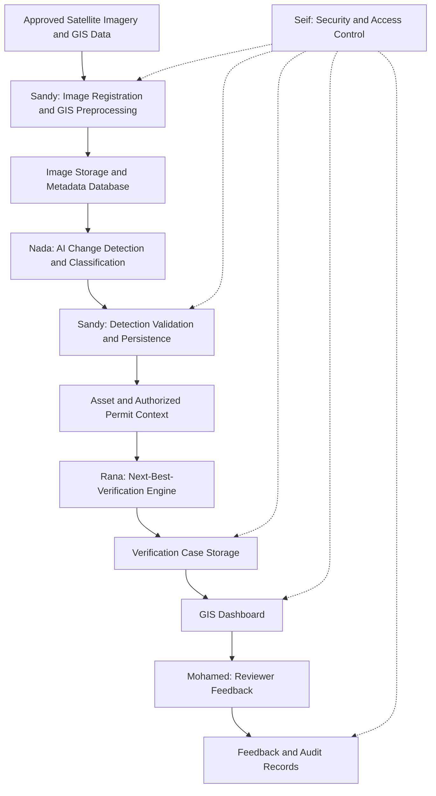

# System Data Flow

## Project
Space-Based Infrastructure Intelligence Platform

## 1. Overview

This document describes how data moves between the platform's components, how each team member contributes to the workflow, and where information is stored.

The workflow begins with approved satellite imagery and geographic information and ends with an infrastructure monitoring recommendation presented to an authorized reviewer.

## 2. End-to-End Data Flow

## 3. Component Inputs and Outputs

| Component | Owner | Input | Output |
|---|---|---|---|
| Data ingestion | Sandy | Approved satellite imagery | Registered image metadata and file references |
| GIS preprocessing | Sandy | Registered images and geographic metadata | Validated geospatial information |
| AI processing | Nada | Before/after image references | Detected changes, classification, confidence and evidence quality |
| Detection persistence | Sandy | AI detection results | Validated and stored detection records |
| Asset and permit context | Sandy | Detection geometry, asset records and authorized permit data | Contextual information for verification |
| NBVE | Rana | Detection and contextual information | Ranked verification recommendations |
| Dashboard | Rana | Stored detections and verification cases | Interactive monitoring interface |
| Feedback and audit | Mohamed | Reviewer actions and feedback | Feedback and audit records |
| Security | Seif | User identity and access requests | Authorized access and security controls |

## 4. Data Storage

The backend is responsible for maintaining persistent records and providing API access.

The planned storage structure includes:

- Satellite image metadata and file references in the database.
- Original raster files in approved file or object storage.
- Monitoring area and infrastructure asset geographic information.
- Detection records and their associated image references.
- Authorized permit records and their access classifications.
- Forecast and verification case records.
- User feedback and audit events.

The backend currently supports PostgreSQL with PostGIS for spatial data storage and querying. This implementation has been tested against a local Docker PostgreSQL/PostGIS instance. SQLite remains supported for local testing. Production deployment configuration is still pending.

Original satellite imagery must remain unchanged. Large raster files should not be stored directly in ordinary database rows.

## 5. API Communication

The components communicate through versioned backend APIs.

The backend provides or plans to provide endpoints for:

- Satellite image registration and retrieval.
- Monitoring area management.
- Infrastructure asset management.
- Detection creation and retrieval.
- Permit and verification record management.
- Dashboard data retrieval.
- Feedback and audit integration.

JSON request and response contracts must be agreed upon before connecting individual modules.

## 6. Integration Dependencies

- Nada must provide the agreed detection JSON schema and sample predictions.
- Rana must provide the NBVE request and response contract.
- Seif must coordinate authentication, authorization and restricted fields.
- Mohamed must define the feedback and audit event requirements.

Independent backend development and testing can proceed using clearly labelled mock data while these interfaces are being finalized.

## 7. Important Constraints

- Only approved satellite imagery and authorized permit information may be used.
- Missing permit records must not automatically indicate illegal activity.
- AI confidence and classification must be preserved.
- Uncertain predictions must be identified as uncertain.
- Verification recommendations must remain subject to human review.
- Access to restricted information must be controlled and auditable.

## 8. Implementation Status

The current backend implementation includes:

- FastAPI application and API endpoints.
- Satellite image registration and metadata extraction.
- Image and detection database persistence.
- Monitoring area registration and retrieval.
- GIS boundary validation.
- Automated backend tests and GitHub Actions.

The following components remain planned or dependent on integration:

- Production PostgreSQL/PostGIS deployment configuration.
- Infrastructure asset management.
- Advanced spatial queries.
- AI model integration.
- Permit-record integration.
- NBVE integration.
- Dashboard, feedback and audit integration.

This document represents the proposed end-to-end architecture while distinguishing implemented backend functionality from planned integrations.
