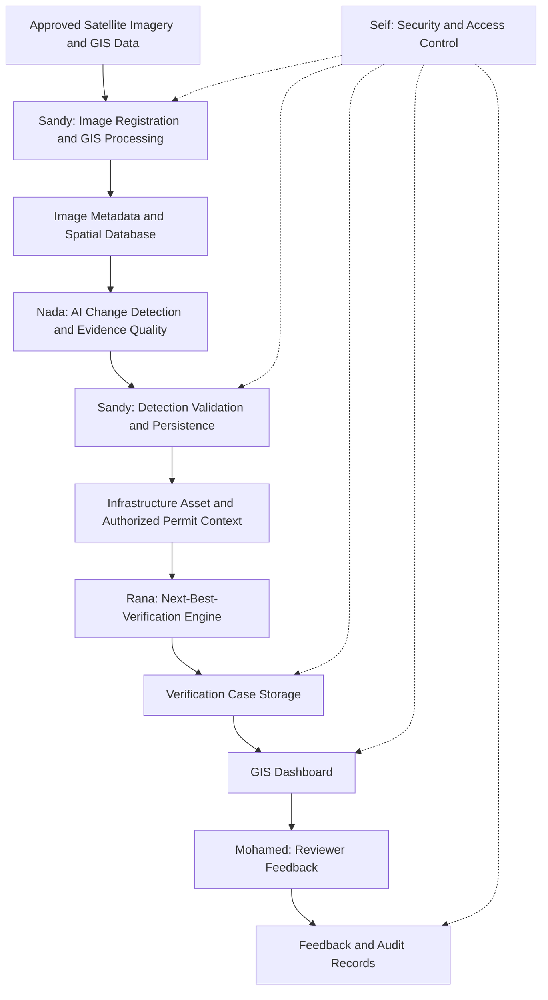

# System Data Flow

## 1. Overview
This document describes how approved satellite imagery and GIS information move through the platform and how the team components are expected to integrate.

## 2. End-to-End Data Flow

The diagram represents the intended end-to-end workflow. Not every connection is implemented yet.

## 3. Component Inputs and Outputs

| Component | Owner | Input | Output |
|---|---|---|---|
| Image registration | Sandy | Approved imagery metadata and file references | Registered image records |
| GIS processing | Sandy | Monitoring boundaries and asset geometries | Validated geometries in EPSG:4326 |
| AI processing | Nada | Before/after image references | Detected changes, classification, confidence and evidence quality |
| Detection persistence | Sandy | Detection results | Validated and stored detection records |
| Asset and permit context | Sandy | Detection and asset information; authorized permit data when integrated | Context for verification |
| NBVE | Rana | Detection and contextual information | Ranked verification recommendations |
| Dashboard | Rana | Detections and verification cases | Monitoring interface |
| Feedback and audit | Mohamed | Reviewer actions and feedback | Feedback and audit records |
| Security | Seif | User identity and access requests | Authentication and access controls |

## 4. Current Backend Storage

Implemented database entities:
- MonitoringArea.
- SatelliteImage.
- InfrastructureAsset.
- Detection.

The backend supports PostgreSQL with PostGIS for native geometry storage and spatial queries. This configuration has been tested locally using Docker. SQLite is supported for development and automated tests.

Current geometry storage uses EPSG:4326. Monitoring area and infrastructure asset geometries are transformed into this CRS. Detection geometry is currently Point.

Satellite image metadata and file references are stored in the database. Registration does not itself upload or process the referenced raster file.

Original satellite imagery must remain unchanged. Production file/object storage remains to be selected.

## 5. Implemented API Communication

The backend currently provides:
- Monitoring area creation and retrieval.
- Infrastructure asset registration, retrieval, and filtering.
- Satellite image metadata registration and retrieval.
- Detection creation, retrieval, and filtering.
- Nearby detection queries around infrastructure assets.

API request and response details are documented in `docs/API.md`.

Permit, verification-case, feedback, audit, and dashboard-specific integration endpoints remain pending.

## 6. Integration Dependencies

- Nada must confirm the detection JSON schema, geometry type, CRS, model version, confidence, evidence-quality fields, and sample outputs.
- Rana must confirm the NBVE input/output contract and verification-case storage requirements.
- Seif must coordinate authentication, authorization, and restricted fields.
- Mohamed must define feedback and audit event requirements.

Independent development may use clearly labelled mock data until these contracts are agreed.

## 7. Important Constraints

- Only approved satellite imagery and authorized permit information may be used.
- Missing permit records must not automatically indicate illegal activity.
- AI confidence, classification, and uncertainty must be preserved.
- Verification recommendations must remain subject to human review.
- Restricted information must be controlled and auditable.

## 8. Implementation Status

**Implemented and locally tested:**
- FastAPI backend and versioned API.
- Satellite image metadata registration and raster metadata extraction.
- Monitoring area creation and retrieval.
- Infrastructure asset registration, retrieval, filtering, and geometry validation.
- Detection creation, persistence, retrieval, and filtering.
- CRS transformation and EPSG:4326 geometry storage.
- PostgreSQL/PostGIS integration and spatial indexes.
- Nearby detection spatial query.
- Automated tests and GitHub Actions workflow.

**Pending or dependent on integration:**
- Production database deployment.
- Production raster file/object storage.
- AI model and evidence-quality integration.
- Permit data integration.
- NBVE and verification-case integration.
- Authentication and authorization.
- Dashboard integration.
- Feedback and audit integration.

This document distinguishes the implemented Backend and GIS functionality from the remaining platform-wide integrations.
