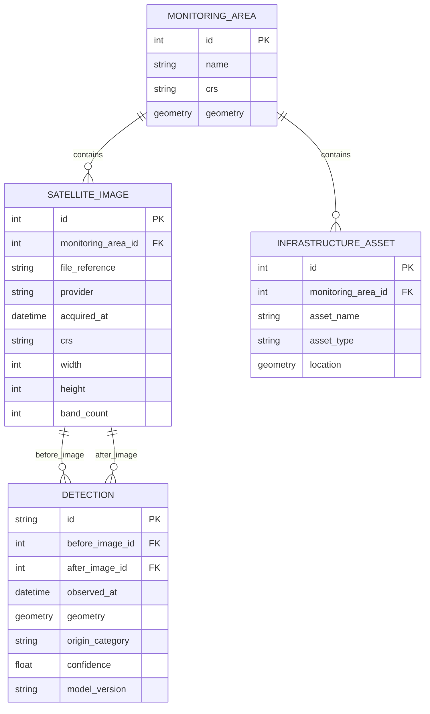

# Database Design

## Project
Space-Based Infrastructure Intelligence Platform

## Initial Database Entities

The first backend implementation includes:

1. MonitoringArea
2. SatelliteImage
3. InfrastructureAsset
4. Detection

Additional entities for permits, forecasting,
verification cases, users, feedback, and audit
logging will be integrated with the responsible
team members.

## Entity Relationship Diagram

## Geographic Data Storage

The backend supports PostgreSQL with PostGIS
for native geographic geometry storage.

| Entity | Geometry column | PostgreSQL type |
|---|---|---|
| MonitoringArea | geometry | GEOMETRY (SRID 4326) |
| InfrastructureAsset | location | GEOMETRY (SRID 4326) |
| Detection | geometry | POINT (SRID 4326) |

SQLite remains supported for local development
and automated testing, using JSON geometry storage.

The API exchanges geographic information using GeoJSON.

## Spatial Indexes

Three GiST spatial indexes have been implemented
and verified in PostgreSQL:

- monitoring_areas.geometry
- infrastructure_assets.location
- detections.geometry

These indexes support efficient geographic queries.

## Data Design Rules

- Every entity has a unique identifier.
- Satellite images reference their monitoring area.
- Infrastructure assets reference their monitoring area.
- Detections reference before and after satellite images.
- Geographic features use EPSG:4326.
- PostgreSQL uses native PostGIS geometry storage.
- SQLite uses JSON geometry storage.
- Confidence scores range from 0 to 1.
- Original satellite files are referenced, not modified.
- Restricted data must not be committed to GitHub.

## Future Database Integration

The design will later include:

- PermitRecord
- Forecast
- VerificationCase
- User
- Feedback
- AuditLog

Their schemas must be agreed with the responsible
members before implementation.

Production deployment configuration remains pending.
