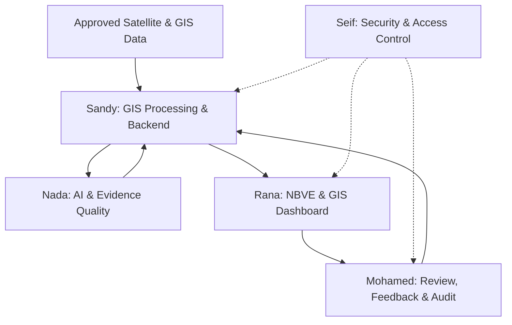

# System Architecture

## Project
Space-Based Infrastructure Intelligence Platform

## Architecture Overview

The platform processes approved multi-date satellite imagery
and GIS data to monitor infrastructure changes.

The backend integrates geospatial data, AI results,
permit information, verification recommendations,
and analyst feedback.

## System Architecture Diagram



## Main Components

### 1. Data Ingestion and GIS Processing
Owner: Sandy

Responsibilities:
- Register approved satellite images.
- Extract geospatial metadata.
- Validate image information.
- Process geographic boundaries.
- Store image and infrastructure records.

### 2. AI Processing
Owner: Nada

Responsibilities:
- Detect changes between satellite images.
- Classify human-made and natural changes.
- Evaluate confidence and evidence quality.
- Develop predictive forecasting.

### 3. Verification Intelligence
Owner: Rana

Responsibilities:
- Prioritize detected changes.
- Implement the Next-Best-Verification Engine.
- Recommend verification actions.
- Develop the GIS dashboard.

### 4. Security
Owner: Seif

Responsibilities:
- Authentication.
- Role-based access control.
- Data integrity.
- Trusted evidence management.

### 5. Feedback and Evaluation
Owner: Mohamed

Responsibilities:
- Analyst review workflow.
- Feedback recording.
- Audit logging.
- Testing and evaluation.

## Backend Technology Stack

- Python
- FastAPI
- PostgreSQL
- PostGIS
- SQLAlchemy
- Rasterio
- GeoPandas
- GeoAlchemy2

## Security and Data Constraints

- Only approved datasets may be processed.
- Original satellite evidence must be preserved.
- Permit records require separate authorization.
- Missing permits do not establish illegal activity.
- Verification decisions remain subject to human review.
```
