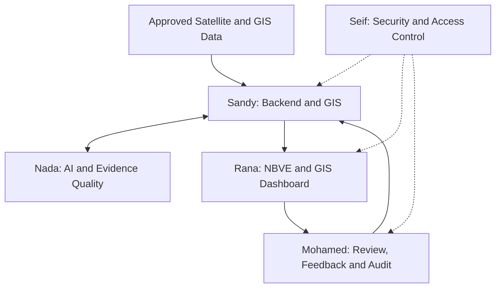

# System Architecture

## Project
Space-Based Infrastructure Intelligence Platform

## 1. Architecture Overview
The platform processes approved multi-date satellite imagery and GIS data to monitor infrastructure changes.

The Backend and GIS component provides image metadata registration, geographic validation, spatial storage, and detection APIs. AI, verification, security, dashboard, feedback, and audit components are developed by their respective team members and require agreed integration contracts.

## 2. System Architecture Diagram

The diagram represents the intended component communication, not a claim that every integration is already connected.

## 3. Main Components

### 3.1 Data Ingestion and GIS Processing
**Owner:** Sandy

Responsibilities:
- Register approved satellite image metadata and file references.
- Extract raster metadata.
- Validate geographic boundaries and asset geometries.
- Transform supported geometries into EPSG:4326.
- Store image, monitoring area, asset, and detection records.
- Provide spatial queries through backend APIs.

**Status:** Core backend and GIS functionality implemented and tested locally.

### 3.2 AI Processing
**Owner:** Nada

Responsibilities:
- Detect changes between satellite images.
- Classify human-made and natural changes.
- Evaluate confidence and evidence quality.
- Develop predictive forecasting.

**Status:** AI integration contract and backend connection pending.

### 3.3 Verification Intelligence
**Owner:** Rana

Responsibilities:
- Prioritize detected changes.
- Implement the Next-Best-Verification Engine.
- Recommend verification actions.
- Develop the GIS dashboard.

**Status:** NBVE and backend integration contract pending.

### 3.4 Security
**Owner:** Seif

Responsibilities:
- Authentication.
- Role-based access control.
- Restricted-data access.
- Trusted evidence management.

**Status:** Integration pending.

### 3.5 Feedback and Evaluation
**Owner:** Mohamed

Responsibilities:
- Analyst review workflow.
- Feedback recording.
- Audit logging.
- Testing and evaluation.

**Status:** Integration pending.

## 4. Backend Technology Stack
- Python 3.13.
- FastAPI.
- SQLAlchemy.
- PostgreSQL and PostGIS.
- GeoAlchemy2.
- Rasterio.
- GeoPandas.
- Shapely.
- PyProj.
- Alembic.
- Pytest.

## 5. Data and CRS Standards
- Backend geometry storage CRS: EPSG:4326.
- GeoJSON coordinate order: longitude, latitude.
- Monitoring areas: Polygon or MultiPolygon.
- Infrastructure assets: supported GeoJSON geometry types.
- Current detection geometry: Point.
- Satellite images retain source CRS metadata.
- Before and after images used in a detection must have matching CRS metadata.

## 6. Security and Data Constraints
- Only approved datasets may be processed.
- Original satellite evidence must be preserved.
- Permit records require separate authorization.
- Missing permits do not establish illegal activity.
- Verification decisions remain subject to human review.

## 7. Deployment Status
PostgreSQL/PostGIS integration has been tested locally. Production deployment, production raster storage, and full team integration remain pending.
